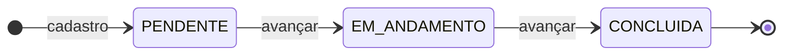

# Documento de Requisitos e Regras de Negócio

**Sistema de Gerenciamento de Obrigações**

| | |
|---|---|
| **Versão** | 1.0 |
| **Data** | 25/11/2026 |
| **Autor** | rafaelsdiniz |
| **Situação** | Aprovado para implementação |

## Controle de versões

| Versão | Data | Descrição |
|---|---|---|
| 1.0 | 25/11/2026 | Versão inicial: escopo, requisitos funcionais, regras de negócio e requisitos não funcionais. |

---

## 1. Introdução

### 1.1 Propósito

Este documento especifica os requisitos funcionais, as regras de negócio e os requisitos não funcionais do Sistema de Gerenciamento de Obrigações. Ele é a referência para implementação, testes e validação da entrega.

### 1.2 Escopo

O sistema apoia um escritório de contabilidade no controle das obrigações (fiscais, contábeis, trabalhistas e afins) de suas empresas clientes. Ele permite:

- manter o cadastro de **empresas** clientes e de **usuários** (colaboradores do escritório);
- registrar **obrigações** vinculadas a uma empresa e a um usuário responsável;
- acompanhar o andamento de cada obrigação por um **fluxo de status** controlado;
- anexar e recuperar **documentos** relacionados a cada obrigação.

**Fora do escopo desta versão:** autenticação e controle de acesso, notificações, geração automática de obrigações recorrentes e integrações com órgãos públicos. Esses pontos estão listados em [Melhorias futuras](#8-melhorias-futuras).

### 1.3 Público-alvo

Avaliadores técnicos, desenvolvedores do backend e do frontend e responsáveis pelos testes.

### 1.4 Documentos relacionados

| Documento | Conteúdo |
|---|---|
| [02-arquitetura.md](02-arquitetura.md) | Arquitetura do sistema, modelo de dados e decisões técnicas |
| [03-api.md](03-api.md) | Contrato da API REST |
| [04-estrategia-de-testes.md](04-estrategia-de-testes.md) | Estratégia e critérios de testes |
| [05-guia-de-contribuicao.md](05-guia-de-contribuicao.md) | Padrões de código, fluxo de Git e definição de pronto |
| [adr/](adr/) | Registros de decisões arquiteturais |

---

## 2. Glossário

| Termo | Definição |
|---|---|
| **Empresa** | Pessoa jurídica cliente do escritório, identificada pelo CNPJ. |
| **Usuário** | Colaborador do escritório que pode ser designado responsável por obrigações. |
| **Obrigação** | Atividade que o escritório deve cumprir para uma empresa até uma data de vencimento (ex.: entrega da DCTFWeb, apuração do Simples Nacional, folha de pagamento). |
| **Responsável** | Usuário designado para executar uma obrigação. |
| **Competência** | Mês e ano de referência a que a obrigação se refere (ex.: 10/2026). |
| **Vencimento** | Data-limite para cumprimento da obrigação. |
| **Status** | Estágio da obrigação no fluxo: Pendente, Em andamento ou Concluída. |
| **Situação** | Estado cadastral de empresa ou usuário: Ativo ou Inativo. |
| **Atribuição** | Vínculo de uma empresa ou de um usuário a uma obrigação, na criação ou na edição. |
| **Anexo** | Arquivo vinculado a uma obrigação (guia, recibo, declaração, planilha etc.). |
| **CNPJ alfanumérico** | Formato de CNPJ com letras nas 12 primeiras posições, emitido pela Receita Federal a partir de julho de 2026 (IN RFB nº 2.229/2024). |

---

## 3. Atores

| Ator | Descrição |
|---|---|
| **Colaborador do escritório** | Usa o aplicativo para cadastrar empresas, usuários e obrigações, acompanhar o andamento e gerenciar anexos. Nesta versão, todos os colaboradores têm o mesmo nível de acesso. |
| **Sistema cliente** | Qualquer cliente da API REST (o aplicativo Flutter, ferramentas de integração ou testes automatizados). |

---

## 4. Requisitos funcionais

Prioridade segundo MoSCoW: **M** (obrigatório), **S** (importante), **C** (desejável).

### 4.1 Empresas

| ID | Requisito | Prioridade |
|---|---|---|
| RF-01 | Cadastrar empresa com razão social, nome fantasia, CNPJ, e-mail e telefone. | M |
| RF-02 | Consultar empresa pelo identificador. | M |
| RF-03 | Listar empresas com paginação, ordenação e filtros por texto (razão social, nome fantasia ou CNPJ) e por situação. | M |
| RF-04 | Editar os dados cadastrais de uma empresa. | M |
| RF-05 | Ativar e inativar empresa. | M |

### 4.2 Usuários

| ID | Requisito | Prioridade |
|---|---|---|
| RF-06 | Cadastrar usuário com nome, e-mail e cargo. | M |
| RF-07 | Consultar usuário pelo identificador. | M |
| RF-08 | Listar usuários com paginação, ordenação e filtros por texto (nome ou e-mail) e por situação. | M |
| RF-09 | Editar os dados cadastrais de um usuário. | M |
| RF-10 | Ativar e inativar usuário. | M |

### 4.3 Obrigações

| ID | Requisito | Prioridade |
|---|---|---|
| RF-11 | Cadastrar obrigação com título, descrição, tipo, competência, data de vencimento, empresa e usuário responsável. | M |
| RF-12 | Consultar obrigação pelo identificador, com os dados resumidos da empresa e do responsável. | M |
| RF-13 | Listar obrigações com paginação, ordenação e filtros por texto, empresa, responsável, status, tipo, intervalo de vencimento e atraso. | M |
| RF-14 | Editar os dados de uma obrigação não concluída. | M |
| RF-15 | Avançar o status de uma obrigação para a próxima etapa do fluxo (Pendente → Em andamento → Concluída). | M |
| RF-16 | Informar, em cada obrigação, o próximo status permitido, ou nenhum quando concluída. | M |
| RF-17 | Consultar o histórico de transições de status de uma obrigação. | S |
| RF-18 | Indicar se uma obrigação está atrasada. | S |
| RF-19 | Obter um resumo com a quantidade de obrigações por status e de obrigações atrasadas, com os mesmos filtros de empresa e responsável. | C |

### 4.4 Anexos

| ID | Requisito | Prioridade |
|---|---|---|
| RF-20 | Enviar um ou mais arquivos para uma obrigação. | M |
| RF-21 | Listar os anexos de uma obrigação com nome, tipo, tamanho e data de envio. | M |
| RF-22 | Baixar um anexo com o nome e o tipo originais. | M |
| RF-23 | Excluir um anexo de obrigação não concluída. | S |

### 4.5 Aplicativo (frontend)

| ID | Requisito | Prioridade |
|---|---|---|
| RF-24 | Oferecer telas de listagem, cadastro, edição e ativação/inativação de empresas e usuários. | M |
| RF-25 | Oferecer telas de listagem com filtros, cadastro, edição e detalhe de obrigações. | M |
| RF-26 | Exibir no detalhe da obrigação apenas a próxima ação de status permitida. | M |
| RF-27 | Exibir no detalhe da obrigação o histórico de status e os anexos, permitindo enviar, baixar e excluir arquivos. | M |
| RF-28 | Oferecer apenas empresas e usuários ativos nos seletores de atribuição. | M |
| RF-29 | Exibir painel inicial com o resumo das obrigações e os próximos vencimentos. | C |
| RF-30 | Exibir as mensagens de erro da API junto ao campo correspondente ou como aviso na tela. | M |

---

## 5. Regras de negócio

Todas as regras são garantidas pelo **backend**. O frontend as reflete para orientar o usuário, mas nunca é a única barreira.

### 5.1 Empresas

| ID | Regra |
|---|---|
| RN-01 | Toda empresa é criada com situação **Ativo**. |
| RN-02 | Razão social e CNPJ são obrigatórios. Nome fantasia, e-mail e telefone são opcionais. |
| RN-03 | O CNPJ deve ser válido nos formatos **numérico** ou **alfanumérico** (dígitos verificadores pelo módulo 11) e é aceito com ou sem máscara. É armazenado sem máscara e em maiúsculas. |
| RN-04 | Não podem existir duas empresas com o mesmo CNPJ. |
| RN-05 | A empresa nunca é excluída. Inativar mantém o registro e todo o seu histórico disponível para consulta. |
| RN-06 | Ativar uma empresa já ativa, ou inativar uma já inativa, não gera erro (operação idempotente). |

### 5.2 Usuários

| ID | Regra |
|---|---|
| RN-07 | Todo usuário é criado com situação **Ativo**. |
| RN-08 | Nome e e-mail são obrigatórios. O cargo é opcional. |
| RN-09 | O e-mail é armazenado em minúsculas e não pode se repetir entre usuários. |
| RN-10 | O usuário nunca é excluído. Inativar mantém o registro e todo o seu histórico disponível para consulta. |
| RN-11 | Ativar e inativar são operações idempotentes. |

### 5.3 Situação e atribuições

| ID | Regra |
|---|---|
| RN-12 | Empresa ou usuário **inativo não pode ser usado em novas atribuições**: não pode ser escolhido ao cadastrar uma obrigação nem ser o novo vínculo ao editar uma. |
| RN-13 | Inativar uma empresa ou um usuário **não altera** as obrigações já existentes, que continuam vinculadas e consultáveis. |
| RN-14 | Editar uma obrigação **mantendo** empresa ou responsável que ficou inativo é permitido, pois não é uma nova atribuição. |
| RN-15 | Mudar o status de uma obrigação cuja empresa ou responsável está inativo é permitido, pois o andamento do trabalho já atribuído não pode ser bloqueado. |

### 5.4 Obrigações

| ID | Regra |
|---|---|
| RN-16 | Título, tipo, data de vencimento, empresa e responsável são obrigatórios. Descrição e competência são opcionais. |
| RN-17 | O tipo é um destes: **Fiscal**, **Contábil**, **Trabalhista**, **Previdenciária**, **Societária** ou **Outra**. |
| RN-18 | A data de vencimento e a competência devem estar entre os anos 2000 e 2100. |
| RN-19 | Toda obrigação é criada com status **Pendente**. O status não é aceito no cadastro nem na edição. Ele só muda pelas ações de status. |
| RN-20 | Uma obrigação **concluída não pode ser editada**. |
| RN-21 | A obrigação nunca é excluída. |
| RN-22 | Uma obrigação está **atrasada** quando não está concluída e a data de vencimento é anterior à data atual no fuso do escritório (configurável, padrão `America/Sao_Paulo`). É uma informação calculada, sem registro próprio. |

### 5.5 Fluxo de status

| ID | Regra |
|---|---|
| RN-23 | O fluxo é sequencial: **Pendente → Em andamento → Concluída**. |
| RN-24 | **Não é permitido retornar** a um status anterior. |
| RN-25 | **Não é permitido pular etapas**: uma obrigação pendente não pode ser concluída diretamente. |
| RN-26 | **Uma obrigação concluída não muda mais de status.** Pedir o status em que a obrigação já está também é recusado. |
| RN-27 | Mudanças de status simultâneas na mesma obrigação são processadas uma de cada vez: a primeira é aplicada e as seguintes são avaliadas sobre o novo status, sem duplicar o histórico. |
| RN-28 | Cada transição, incluindo a criação (sem status → Pendente), gera um registro no **histórico de status** com o status anterior, o novo status e a data e hora. O histórico não pode ser alterado. |

**Matriz de transições**

| De \ Para | Pendente | Em andamento | Concluída |
|---|---|---|---|
| *(criação)* | ✅ | ❌ | ❌ |
| **Pendente** | — | ✅ | ❌ |
| **Em andamento** | ❌ | — | ✅ |
| **Concluída** | ❌ | ❌ | — |

### 5.6 Anexos

| ID | Regra |
|---|---|
| RN-29 | Uma obrigação pode ter vários anexos, inclusive depois de concluída (ex.: recibo de entrega). |
| RN-30 | O arquivo não pode estar vazio e deve ter no máximo **10 MB** (valor configurável). |
| RN-31 | São aceitos os tipos **PDF, PNG, JPEG, XML, CSV, XLSX e DOCX**. O tipo é confirmado pela assinatura do conteúdo do arquivo, e não apenas pela extensão. |
| RN-32 | O nome original do arquivo é preservado para exibição e download. O arquivo é armazenado com um identificador gerado pelo sistema, nunca com o nome enviado. |
| RN-33 | É calculado e registrado o hash SHA-256 de cada arquivo, para conferência de integridade. |
| RN-34 | Um anexo só pode ser excluído enquanto a obrigação **não estiver concluída**. Depois da conclusão, os documentos ficam preservados como registro do cumprimento. |
| RN-35 | O anexo só é acessível pela obrigação a que pertence: anexo de outra obrigação é tratado como inexistente. |

### 5.7 Regras gerais

| ID | Regra |
|---|---|
| RN-36 | Textos recebidos têm os espaços das pontas removidos. Texto opcional em branco é gravado como vazio (nulo). |
| RN-37 | A edição exige a **versão** do registro lida pelo cliente. Se outro usuário alterou o registro nesse meio-tempo, a edição é recusada com conflito, para evitar sobrescrita silenciosa (concorrência otimista). |
| RN-38 | Toda entidade registra data e hora de criação e da última atualização, em UTC. |
| RN-39 | A ordenação das listagens só aceita campos expostos pela API e usa o identificador como desempate, para que nenhum registro se repita ou suma entre páginas. O tamanho máximo de página é 100. |

---

## 6. Validações de campos

| Entidade | Campo | Obrigatório | Regras |
|---|---|---|---|
| Empresa | Razão social | Sim | Até 150 caracteres |
| Empresa | Nome fantasia | Não | Até 150 caracteres |
| Empresa | CNPJ | Sim | Válido (RN-03) e único (RN-04) |
| Empresa | E-mail | Não | Formato de e-mail, até 150 caracteres |
| Empresa | Telefone | Não | Até 20 caracteres |
| Usuário | Nome | Sim | Até 120 caracteres |
| Usuário | E-mail | Sim | Formato de e-mail, até 150 caracteres, único (RN-09) |
| Usuário | Cargo | Não | Até 80 caracteres |
| Obrigação | Título | Sim | Até 150 caracteres |
| Obrigação | Descrição | Não | Até 2.000 caracteres |
| Obrigação | Tipo | Sim | Um dos valores de RN-17 |
| Obrigação | Competência | Não | `AAAA-MM`, ano entre 2000 e 2100 (RN-18) |
| Obrigação | Vencimento | Sim | `AAAA-MM-DD`, ano entre 2000 e 2100 (RN-18) |
| Obrigação | Empresa | Sim | Existente e ativa na atribuição (RN-12) |
| Obrigação | Responsável | Sim | Existente e ativo na atribuição (RN-12) |
| Anexo | Arquivo | Sim | RN-30 e RN-31 |
| Todas | Versão | Na edição | RN-37 |

---

## 7. Requisitos não funcionais

| ID | Categoria | Requisito |
|---|---|---|
| RNF-01 | Tecnologia | Backend em Java 21 com Spring Boot. Banco de dados MySQL. Frontend em Flutter. |
| RNF-02 | Persistência | A estrutura do banco é versionada por migrations Flyway, executadas automaticamente na inicialização da aplicação. O Hibernate apenas valida o esquema e nunca o altera. |
| RNF-03 | Infraestrutura | Todos os serviços (banco, API e aplicativo web) sobem com um único `docker compose up`. |
| RNF-04 | CI/CD | Cada push e pull request executa compilação, análise estática, testes e build da imagem Docker no GitHub Actions. A imagem é publicada no registro a cada merge na `main`. |
| RNF-05 | API | API REST versionada (`/api/v1`), JSON em UTF-8, documentada em OpenAPI com Swagger UI. |
| RNF-06 | Erros | Todas as respostas de erro seguem a RFC 7807 (Problem Details), com código de erro estável e, em validações, a lista de erros por campo. Detalhes internos (stack trace, SQL) nunca são expostos. |
| RNF-07 | Integridade | Unicidade, chaves estrangeiras e valores permitidos são garantidos também por restrições no banco, não só pela aplicação. |
| RNF-08 | Concorrência | Controle de concorrência otimista na edição de todas as entidades (RN-37) e bloqueio de linha na mudança de status (RN-27). |
| RNF-09 | Segurança | Validação de toda entrada, ordenação restrita a campos permitidos, filtros de texto sem interpretação de curingas, CORS restrito a origens configuradas, contêineres executados sem root e segredos apenas por variáveis de ambiente. |
| RNF-10 | Arquivos | Armazenamento de anexos fora do banco, em volume persistente, atrás de uma interface que permita trocar por armazenamento em nuvem sem alterar o domínio. |
| RNF-11 | Testes | Testes unitários de domínio e serviços e testes de integração com MySQL real (Testcontainers), com cobertura medida no CI. |
| RNF-12 | Observabilidade | Health check (liveness e readiness) exposto pelo Actuator e usado pelo Docker. Logs de erros inesperados no servidor. |
| RNF-13 | Usabilidade | Aplicativo responsivo (web e Android), em português do Brasil, com estados de carregamento, lista vazia e erro em todas as telas. |
| RNF-14 | Configuração | Toda configuração dependente de ambiente (banco, portas, CORS, fuso horário, limite de anexos, URL da API no frontend) é feita por variáveis de ambiente, sem recompilar. |
| RNF-15 | Código | Código autoexplicativo, sem comentários, seguindo as convenções do [Guia de contribuição](05-guia-de-contribuicao.md). |

---

## 8. Melhorias futuras

| Item | Descrição |
|---|---|
| Autenticação e autorização | Login com JWT/OAuth2, perfis de acesso e registro de **quem** executou cada transição de status. |
| Obrigações recorrentes | Modelos de obrigação por empresa gerados automaticamente a cada competência. |
| Notificações | Avisos por e-mail ou no aplicativo de obrigações próximas do vencimento ou atrasadas. |
| Armazenamento em nuvem | Implementação de armazenamento S3/MinIO para os anexos. |
| Calendário fiscal | Sugestão de vencimentos conforme o tipo de obrigação e feriados. |
| Observabilidade | Métricas (Prometheus), tracing distribuído e logs estruturados. |

---

## 9. Rastreabilidade

| Requisito do desafio | Requisitos e regras |
|---|---|
| Cadastrar, consultar e editar empresas e usuários | RF-01 a RF-04, RF-06 a RF-09, RF-24 |
| Controle de situação Ativo/Inativo | RF-05, RF-10, RN-01, RN-05 a RN-07, RN-10, RN-11 |
| Inativos fora de novas atribuições e preservados para consulta | RN-12 a RN-15, RF-28 |
| Cadastrar, consultar e editar obrigações vinculadas a empresa e responsável | RF-11 a RF-14, RF-25, RN-16 a RN-21 |
| Início em Pendente e fluxo Pendente → Em andamento → Concluída | RF-15, RF-16, RN-19, RN-23 |
| Sem retorno de status e sem alterar concluída, garantidos pelo backend | RN-24 a RN-26, RN-20 |
| Múltiplos anexos com upload, consulta e recuperação | RF-20 a RF-22, RF-27, RN-29 a RN-35 |
| API REST, arquitetura organizada, validação e exceções | RNF-05, RNF-06, seção 6 |
| MySQL com migrations automáticas | RNF-01, RNF-02, RNF-07 |
| Docker Compose | RNF-03 |
| CI/CD com compilação, validação e testes | RNF-04, RNF-11 |
