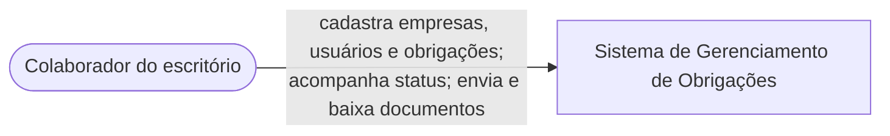
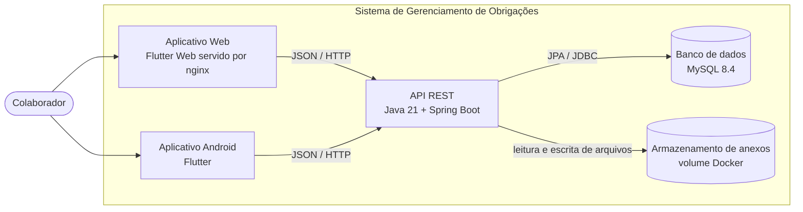
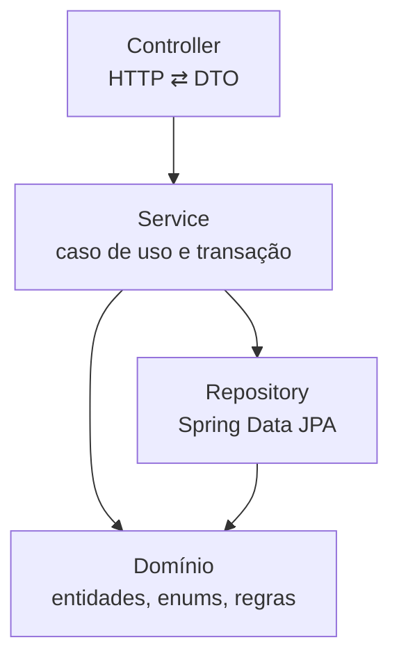
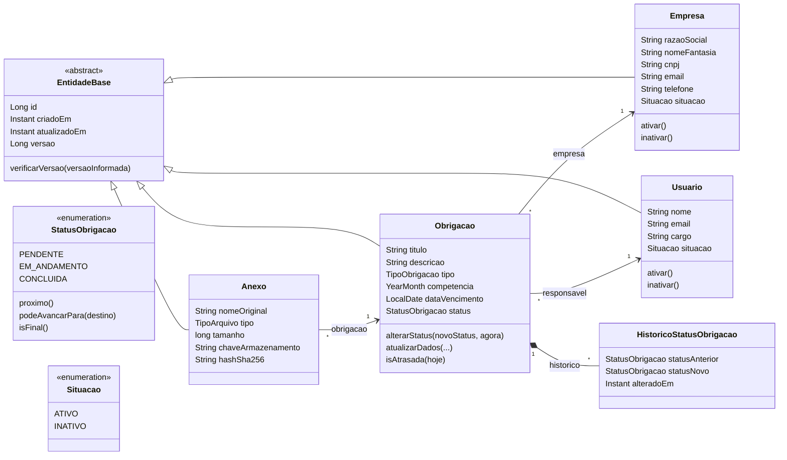
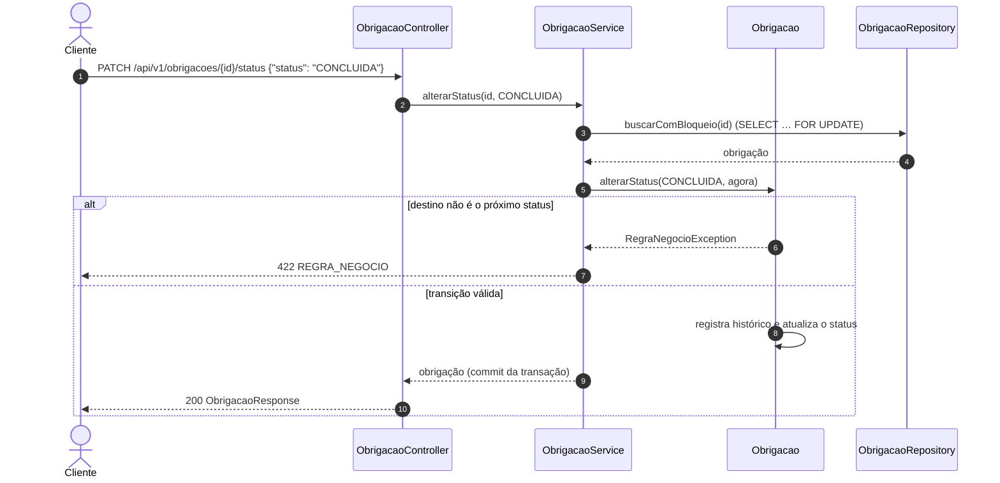
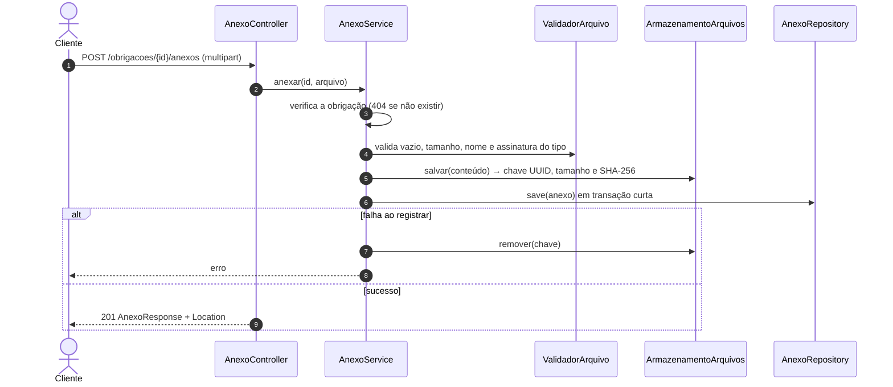
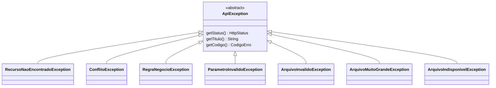
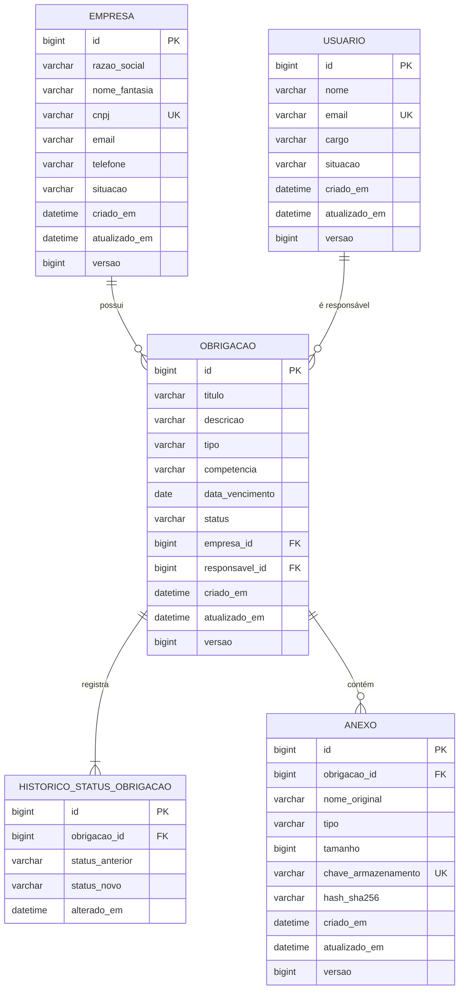
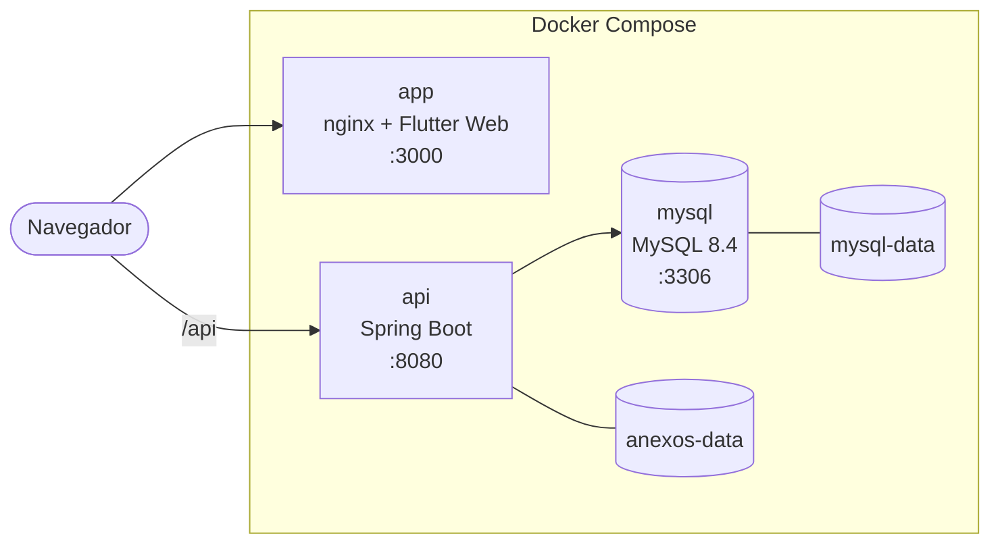
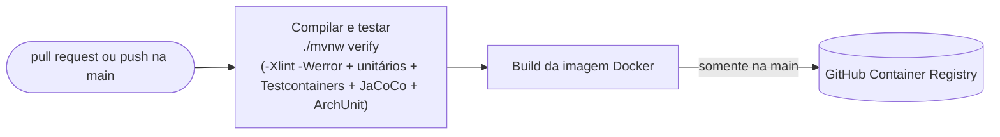

# Documento de Arquitetura de Software

**Sistema de Gerenciamento de Obrigações**

| | |
|---|---|
| **Versão** | 1.1 |
| **Data** | 26/11/2026 |
| **Autor** | rafaelsdiniz |
| **Modelo** | arc42 (resumido), com diagramas C4 |

## Controle de versões

| Versão | Data | Descrição |
|---|---|---|
| 1.0 | 25/11/2026 | Versão inicial. |
| 1.1 | 26/11/2026 | Frontend: painel, obrigações e anexos; regras de tela que complementam as do backend. |
| 1.2 | 26/11/2026 | Frontend: busca global, filtros da lista, tema claro e escuro e design system. Backend: readiness com banco e análise estática na compilação. |

---

## 1. Objetivos e qualidades

O sistema implementa os requisitos de [01-requisitos.md](01-requisitos.md). As decisões de arquitetura buscam, nesta ordem:

| Prioridade | Qualidade | Como é atendida |
|---|---|---|
| 1 | **Corretude das regras de negócio** | Regras no modelo de domínio, protegidas também por restrições no banco e cobertas por testes. |
| 2 | **Manutenibilidade** | Módulos por funcionalidade, camadas com responsabilidade única, contratos da API desacoplados das entidades. |
| 3 | **Testabilidade** | Domínio sem dependência de framework web, serviços com dependências injetadas, testes de integração com MySQL real. |
| 4 | **Portabilidade e reprodutibilidade** | Toda a stack em contêineres, configuração por variáveis de ambiente, migrations versionadas. |
| 5 | **Integridade dos dados** | Concorrência otimista, transações, restrições de unicidade e chaves estrangeiras. |

## 2. Restrições

| Tipo | Restrição |
|---|---|
| Técnica | Java 21, Spring Boot, MySQL, Flutter, Docker Compose, Flyway, GitHub Actions. |
| Organizacional | Dois repositórios (`obrigacoes-backend` e `obrigacoes-frontend`), quadro público no Trello. |
| Escopo | Sem autenticação nesta versão (ver [ADR-0009](adr/0009-sem-autenticacao-na-primeira-versao.md)). |

---

## 3. Contexto (C4 – nível 1)



O sistema é autocontido: não depende de serviços externos para funcionar.

## 4. Containers (C4 – nível 2)



| Container | Responsabilidade | Tecnologia |
|---|---|---|
| Aplicativo (web e Android) | Interface do usuário, validação de formulários e orientação das regras | Flutter, Riverpod, go_router, Dio |
| API REST | Regras de negócio, validação, persistência e armazenamento de anexos | Java 21, Spring Boot 4, Spring Data JPA, Bean Validation, springdoc-openapi |
| Banco de dados | Persistência de empresas, usuários, obrigações, histórico e metadados dos anexos | MySQL 8.4, Flyway |
| Armazenamento de anexos | Conteúdo binário dos arquivos | Sistema de arquivos em volume persistente |

---

## 5. Backend

### 5.1 Organização: módulos por funcionalidade

O código é organizado **por funcionalidade** (*package by feature*), e não por camada técnica. Tudo o que pertence a "obrigação" fica junto, o que reduz o acoplamento entre módulos e deixa claro onde cada regra mora ([ADR-0001](adr/0001-monolito-modular-por-funcionalidade.md)).

```text
br.com.obrigacoes
├── ObrigacoesApiApplication
├── config            CORS, OpenAPI, relógio com fuso do escritório, auditoria JPA e limites de upload
├── empresa           Empresa, EmpresaRepository, EmpresaService, EmpresaController, dto/
├── usuario           Usuario, UsuarioRepository, UsuarioService, UsuarioController, dto/
├── obrigacao         Obrigacao, StatusObrigacao, TipoObrigacao, HistoricoStatus, ..., dto/
├── anexo             Anexo, AnexoService, AnexoController, ArmazenamentoArquivos, ..., dto/
└── shared
    ├── domain        EntidadeBase, Situacao, Textos
    ├── exception     ApiException e subclasses, CodigoErro, GlobalExceptionHandler
    ├── persistence   utilitários de consulta
    ├── validation    CNPJ, grupos de validação
    └── web           paginação e resposta paginada
```

### 5.2 Camadas dentro de cada módulo



| Camada | Responsabilidade | Não faz |
|---|---|---|
| **Controller** | Mapeia rotas, valida o formato da entrada (Bean Validation), converte entidade em DTO de resposta, define status HTTP e cabeçalhos. | Regra de negócio, acesso a repositório. |
| **Service** | Orquestra o caso de uso: busca entidades, aplica verificações que dependem do banco (unicidade, situação ativa), delega a regra ao domínio, delimita a transação. | Conhecer HTTP. |
| **Domínio** | Entidades ricas com invariantes e transições (`obrigacao.alterarStatus()`, `obrigacao.atualizarDados()`, `empresa.inativar()`). | Conhecer Spring Web ou DTOs. |
| **Repository** | Consultas e persistência. Filtros dinâmicos com `Specification`. | Regra de negócio. |

As regras de dependência são verificadas a cada build por testes com ArchUnit (`ArquiteturaTest`):

- repositórios só são usados por serviços, e controllers nunca acessam repositórios;
- entidades não dependem de DTOs nem de classes web;
- serviços não dependem de HTTP (`org.springframework.http`, `web.bind`, `jakarta.servlet`);
- o pacote `shared` não depende de nenhuma funcionalidade;
- não há dependência cíclica entre módulos;
- não há injeção por campo, `System.out` nem `java.util.logging`.

### 5.3 Modelo de domínio



**Princípios aplicados**

- **Entidades ricas**: o estado só muda por métodos com intenção de negócio. Não há *setters* públicos.
- **Máquina de estados no enum**: `StatusObrigacao.proximo()` define a única transição válida a partir de cada status. A entidade a consulta antes de mudar o status e registra o histórico na mesma operação ([ADR-0004](adr/0004-maquina-de-estados-no-dominio.md)).
- **Dados derivados não são gravados**: o atraso é calculado a partir do vencimento e do status, nunca fica desatualizado.
- **Histórico como composição**: `HistoricoStatusObrigacao` só é criado pela própria `Obrigacao`, em cascata, e nunca é alterado.
- **Anexo como agregado separado**: o anexo referencia a obrigação, mas a obrigação não carrega a lista de anexos, o que evita carregar metadados de arquivos em cada consulta de obrigação.

### 5.4 Fluxos principais

**Avançar o status de uma obrigação**



**Enviar um anexo**

A validação e a gravação do arquivo acontecem **fora da transação**, para que uploads lentos não segurem conexões do banco. A transação é curta e só registra o anexo.



### 5.5 Tratamento de erros

Todas as falhas viram uma resposta **RFC 7807** montada em um único ponto, o `GlobalExceptionHandler` ([ADR-0005](adr/0005-erros-no-padrao-problem-details.md)). As exceções de negócio estendem `ApiException`, que já sabe o próprio status HTTP e o código de erro.



| Situação | HTTP | `codigo` |
|---|---|---|
| Campos inválidos (Bean Validation) | 400 | `VALIDACAO` (com a lista `erros` por campo) |
| JSON malformado, parâmetro ausente ou com tipo errado, ordenação não permitida | 400 | `REQUISICAO_INVALIDA` |
| Arquivo vazio ou de tipo não permitido | 400 | `ARQUIVO_INVALIDO` |
| Arquivo acima do limite (`ArquivoMuitoGrandeException`, também usada quando o próprio servidor recusa o multipart) | 413 | `ARQUIVO_INVALIDO` |
| Registro ou rota inexistente, arquivo de anexo indisponível no armazenamento (`ArquivoIndisponivelException`) | 404 | `RECURSO_NAO_ENCONTRADO` |
| Método HTTP não suportado ou tipo de conteúdo não aceito | 405 ou 415 | `REQUISICAO_INVALIDA` |
| CNPJ ou e-mail duplicado, versão desatualizada, bloqueio concorrente no banco, violação de restrição | 409 | `CONFLITO` |
| Regra de negócio violada (transição inválida, inativo em atribuição, edição de concluída) | 422 | `REGRA_NEGOCIO` |
| Erro inesperado (registrado em log, sem detalhes na resposta) | 500 | `ERRO_INTERNO` |

### 5.6 Persistência

| Aspecto | Decisão |
|---|---|
| Esquema | Versionado por Flyway (`V{n}__descricao.sql`), aplicado na inicialização. O Hibernate roda com `ddl-auto: validate` e falha se o esquema divergir das entidades. |
| Identificadores | `BIGINT AUTO_INCREMENT`. |
| Concorrência | Coluna `versao` com `@Version`: a edição compara a versão enviada pelo cliente. A mudança de status usa bloqueio de linha (`SELECT … FOR UPDATE`) para serializar pedidos simultâneos ([ADR-0006](adr/0006-concorrencia-otimista.md)). |
| Datas | `DATETIME(6)` em UTC, preenchidas pelo Spring Data Auditing com o `Clock` da aplicação, o mesmo usado nas regras de negócio e fixado nos testes. |
| Unicidade | Restrições `UNIQUE` em `empresa.cnpj` e `usuario.email`, com colação binária para comparar exatamente o valor normalizado. |
| Valores permitidos | Restrições `CHECK` para situação, status e tipo. |
| Integridade referencial | Chaves estrangeiras de obrigação para empresa e usuário, e de histórico e anexo para obrigação. |
| *Open Session in View* | Desativado. Consultas carregam explicitamente o que a resposta precisa (`@EntityGraph`), sem *lazy loading* fora da transação. |

### 5.7 Modelo de dados



**Índices**: situação e nome em empresa e usuário; em obrigação, `data_vencimento` e `(status, data_vencimento)`, que atende a listagem por status e o filtro de atrasadas, além dos índices das chaves estrangeiras; `(obrigacao_id, alterado_em)` no histórico; `(obrigacao_id, criado_em)` em anexo, que atende a listagem do mais recente ao mais antigo.

### 5.8 Armazenamento de anexos

O conteúdo dos arquivos fica **fora do banco**, e o banco guarda apenas os metadados ([ADR-0007](adr/0007-anexos-fora-do-banco.md)). O acesso passa pela interface `ArmazenamentoArquivos` (`salvar`, `abrir`, `remover`). A implementação atual, `ArmazenamentoLocal`, grava em `${APP_ANEXOS_DIRETORIO}/{obrigacaoId}/{uuid}`, no volume `anexos-data`, e calcula o SHA-256 durante a própria gravação. Uma implementação S3/MinIO pode substituí-la sem alterar o domínio nem os serviços.

| Componente | Responsabilidade |
|---|---|
| `ValidadorArquivo` | Arquivo presente e não vazio, tamanho máximo, nome sanitizado (`NomesDeArquivo`) e tipo permitido |
| `TipoArquivo` | Tipos aceitos, com tipo de conteúdo e assinatura de cada um |
| `Assinaturas` | Reconhecimento pelo conteúdo: bytes iniciais (PDF, PNG, JPEG), texto sem bytes de controle (CSV, XML) e entradas internas do zip (`xl/` no XLSX, `word/` no DOCX) |
| `ArmazenamentoLocal` | Gravação, leitura e remoção no disco |
| `LimpezaDeArquivos` | Remove o arquivo de um anexo excluído **depois do commit**, por evento transacional |
| `UploadConfig` | Deriva os limites do multipart do servidor de `app.anexos.tamanho-maximo`, fonte única do limite |

Consistência entre banco e disco:
- **Envio**: se o registro no banco falhar depois de gravar o arquivo, o serviço remove o arquivo antes de propagar o erro.
- **Exclusão**: o arquivo só é removido depois que a exclusão é confirmada no banco. Se a transação for desfeita, o arquivo continua lá.
- A remoção é de **melhor esforço**. Uma falha de disco ou a queda do processo entre a gravação e o commit pode deixar um arquivo sem registro, o que é registrado em log e não afeta os dados. A situação inversa, um registro sem arquivo, não acontece nos fluxos normais.

Medidas de segurança:
- o caminho é montado só com identificadores gerados pelo sistema, a pasta passa por lista de caracteres permitidos e o caminho final é conferido dentro do diretório raiz, o que elimina *path traversal*;
- o tipo é validado pela assinatura do conteúdo. A inspeção de zip para em 50 entradas e em 16 MB descompactados, o que protege contra *zip bomb*;
- o nome é usado só para exibição: caracteres invisíveis (como o U+202E, que inverte a direção do texto e disfarça a extensão) são removidos;
- o download usa `Content-Disposition: attachment` com o nome original codificado (RFC 6266), `X-Content-Type-Options: nosniff` e `Content-Security-Policy: sandbox`, e o `Content-Type` vem do tipo validado, nunca do cliente.

Limitações conhecidas: CSV e XML são reconhecidos como texto genérico (um HTML renomeado para `.csv` é aceito, mas é sempre baixado como anexo e isolado pelos cabeçalhos acima), e textos em UTF-16 são recusados.

---

## 6. Frontend

### 6.1 Organização

Organização por funcionalidade, com camadas internas ([ADR-0008](adr/0008-arquitetura-do-frontend.md)):

```text
lib/
├── main.dart              carrega a configuração e inicia o app
├── app/                   MaterialApp, roteador (go_router) e navegação (barra lateral, barra superior com busca e tema, barra inferior)
├── core/
│   ├── tema/              paleta clara e escura, tokens de raio, fonte e movimento, preferência de tema salva
│   ├── layout/            pontos de quebra, largura da página, altura dos controles e margens
│   ├── config/            URL da API: config.json na raiz do site ou --dart-define
│   ├── dominio/           Json, situação, filtro e termos dos cadastros
│   ├── estado/            filtro reaproveitável dos cadastros e aviso de alteração entre telas
│   ├── arquivos/          escolha de arquivo, arrastar e soltar e abertura do download
│   ├── formatacao/        CNPJ, datas, competência, tamanhos de arquivo e validações de formulário
│   ├── http/              ClienteApi (Dio), ErroApi, página e parâmetros de listagem
│   └── widgets/           componentes: cabeçalhos, trilha, cartões, filtros e menus, listas, formulários
└── features/
    ├── painel/            indicadores por status e próximos vencimentos
    ├── obrigacoes/        lista com filtros e ordenação, detalhe com etapas e histórico, formulário, regra de prazo
    ├── anexos/            área de envio (seletor ou arrastar), lista, download e exclusão
    ├── busca/             busca global em obrigações, empresas e usuários
    ├── empresas/
    │   ├── data/          EmpresaRepository (HTTP ⇄ modelo)
    │   ├── domain/        modelos imutáveis
    │   └── presentation/  telas, providers, operações de cadastro e rotas da funcionalidade
    └── usuarios/
```

| Camada | Responsabilidade |
|---|---|
| `presentation` | Telas e estado (providers do Riverpod). As operações que alteram dados ficam em uma classe da camada de estado (`CadastroDeEmpresas`), que chama o repositório e invalida a listagem. As telas nunca falam com HTTP. Cada funcionalidade declara as próprias rotas, e o `app` só as compõe. |
| `domain` | Modelos imutáveis, com `deJson`/`paraJson`, espelhando o contrato da API. |
| `data` | Repositórios que chamam a API pelo `ClienteApi` e convertem JSON em modelo. |

O `ClienteApi` envolve o Dio e converte toda falha em `ErroApi`, com o `codigo` estável e os erros por campo do Problem Details. Os formulários usam esses erros no validador do próprio campo. O "Recarregar" aparece só no conflito de versão, que é um 409 sem erro de campo.

As regras de negócio continuam garantidas pelo backend. O aplicativo as reflete para dar uma experiência melhor:

| Regra | Como o aplicativo trata |
|---|---|
| Fluxo de status | O detalhe oferece só a **próxima** ação (iniciar ou concluir), e concluir pede confirmação. Se outra pessoa já avançou (409/422), a tela recarrega a obrigação e o histórico. |
| Concluída não muda | Sem edição e sem avanço; a rota de edição de uma concluída mostra um aviso em vez do formulário. Anexos ainda podem ser enviados, mas não excluídos. |
| Inativo sem nova atribuição | Os seletores de empresa e responsável listam só ativos. Na edição, o vínculo atual aparece marcado como inativo, porque a regra vale só para nova atribuição. |
| Atraso | O campo `atrasada` vem da API, calculado no fuso do escritório. O aplicativo só monta o texto do prazo ("Vence em 3 dias"). |
| Anexos | O seletor oferece só as extensões aceitas; arquivos arrastados passam pela mesma conferência de extensão e tamanho (10 MB) antes do envio. O download abre o endereço do anexo, e o `Content-Disposition` da API faz o navegador salvar com o nome original. |
| Inativos consultáveis | Os filtros da lista de obrigações oferecem também empresas e responsáveis inativos, marcados como tal, porque a regra só impede **novas** atribuições. |

### 6.2 Decisões do frontend

| Tema | Escolha | Motivo |
|---|---|---|
| Estado e injeção de dependência | Riverpod | Estado assíncrono declarativo (`AsyncValue`), fácil de substituir em testes, sem depender da árvore de widgets. |
| Rotas | go_router | Rotas declarativas com URL real na web (deep link, botão voltar). |
| HTTP | Dio, encapsulado no `ClienteApi` | Tradução de erros em um único ponto, upload multipart e testes com adaptador falso. |
| Arquivos | file_picker e url_launcher atrás de `ArquivosDoDispositivo` | Uma interface única para web e Android, substituída por um falso nos testes. |
| Identidade visual | Paleta própria (marinho da marca, amarelo da logo como acento), temas claro e escuro, tipografia Inter e ícones SVG próprios | Poucos tokens (raio, altura de controle, tamanho de ícone, largura de página) garantem que todas as telas tenham a mesma forma. Cores de status com significado fixo e sempre acompanhadas de ícone e texto; contraste WCAG AA nos dois temas e alvos de toque de 48 px verificados por testes automáticos. |
| Busca global | Um campo na barra superior consulta obrigações, empresas e usuários em paralelo | Atalho `/`, navegação por teclado e tela cheia no celular; reaproveita os endpoints de listagem, sem endpoint novo na API. |
| Configuração | `/config.json` lido em runtime | A mesma imagem Docker serve qualquer ambiente, pois a URL da API vem de variável de ambiente do contêiner. Fora da web vale o `--dart-define`, com `10.0.2.2` como padrão no emulador Android. |
| Layout | Barra lateral com a marca (telas largas) e `NavigationBar` (celular e tablet), páginas de largura total | Uma única base de código para web e Android; listas viram tabelas com colunas em telas largas e linhas empilhadas no celular. |

---

## 7. Implantação



| Serviço | Imagem | Saúde | Dependência |
|---|---|---|---|
| `mysql` | `mysql:8.4` | `mysqladmin ping` | — |
| `api` | build local deste repositório (`obrigacoes-api:local`); a CI publica a mesma imagem em `ghcr.io/rafaelsdiniz/obrigacoes-backend` | `/actuator/health/readiness` (inclui o banco) | `mysql` saudável |
| `app` | `ghcr.io/rafaelsdiniz/obrigacoes-frontend` | resposta HTTP do nginx | `api` saudável |

As imagens são construídas em múltiplos estágios (build e runtime separados), rodam com usuário sem privilégios e têm `HEALTHCHECK`.

### 7.1 Variáveis de ambiente

| Variável | Serviço | Padrão | Descrição |
|---|---|---|---|
| `DB_URL` | api | `jdbc:mysql://localhost:3306/obrigacoes…` | URL JDBC |
| `DB_USERNAME` / `DB_PASSWORD` | api, mysql | `obrigacoes` | Credenciais do banco |
| `DB_POOL_SIZE` | api | `10` | Tamanho do pool de conexões |
| `SERVER_PORT` | api | `8080` | Porta HTTP |
| `CORS_ALLOWED_ORIGINS` | api | `http://localhost:3000,…` | Origens permitidas |
| `APP_FUSO_HORARIO` | api | `America/Sao_Paulo` | Fuso usado para "hoje" no cálculo de atraso |
| `APP_ANEXOS_DIRETORIO` | api | `storage/anexos` (`/app/storage` no Compose) | Diretório dos anexos |
| `APP_ANEXOS_TAMANHO_MAXIMO` | api | `10MB` | Tamanho máximo por arquivo |
| `DB_NAME`, `DB_ROOT_PASSWORD`, `DB_PORT`, `API_PORT`, `APP_PORT` | compose | — | Nome do banco, senha root e portas expostas |
| `API_URL_PUBLICA` | compose (vira `API_URL` no app) | `http://localhost:8080` | Endereço da API como o navegador o enxerga |

---

## 8. Integração e entrega contínuas



| Repositório | Etapas |
|---|---|
| Backend | Compilação com `-Xlint:all -Werror`, testes unitários e de integração, ArchUnit, cobertura mínima de 90%, build da imagem e publicação no GHCR com as tags `latest` e SHA curto. |
| Frontend | `dart format --set-exit-if-changed`, `flutter analyze`, `flutter test --coverage`, `flutter build web`, build da imagem e publicação no GHCR. |

Pull requests só são integrados com o pipeline verde.

---

## 9. Segurança

| Ameaça | Mitigação |
|---|---|
| Dados inválidos ou maliciosos | Bean Validation em toda entrada, normalização de textos, restrições no banco. |
| Injeção em consultas | JPA Criteria/Specification com parâmetros. Curingas `%` e `_` digitados pelo usuário são tratados como texto. Ordenação só por campos permitidos. |
| *Path traversal* e upload malicioso | Nome do arquivo nunca usado no disco, tipo validado pelo conteúdo, limite de tamanho, download sempre como `attachment` com `nosniff`. |
| Vazamento de informação | Erros 500 com mensagem genérica, sem stack trace nem SQL. |
| Acesso indevido do navegador | CORS restrito às origens configuradas. |
| Contêineres | Execução sem root, imagens mínimas (JRE Alpine, nginx Alpine). |
| Segredos | Apenas por variáveis de ambiente. `.env` fora do controle de versão, com `.env.example` documentado. |
| Ausência de autenticação | Limitação conhecida desta versão ([ADR-0009](adr/0009-sem-autenticacao-na-primeira-versao.md)). |

---

## 10. Registro de decisões

| ADR | Decisão |
|---|---|
| [0001](adr/0001-monolito-modular-por-funcionalidade.md) | Monólito modular organizado por funcionalidade |
| [0002](adr/0002-flyway-para-migrations.md) | Flyway para versionamento do banco |
| [0003](adr/0003-cnpj-alfanumerico.md) | Suporte ao CNPJ alfanumérico |
| [0004](adr/0004-maquina-de-estados-no-dominio.md) | Fluxo de status como máquina de estados no domínio, com histórico |
| [0005](adr/0005-erros-no-padrao-problem-details.md) | Erros no padrão Problem Details (RFC 7807) |
| [0006](adr/0006-concorrencia-otimista.md) | Concorrência otimista com versão enviada pelo cliente |
| [0007](adr/0007-anexos-fora-do-banco.md) | Anexos fora do banco, atrás de uma interface de armazenamento |
| [0008](adr/0008-arquitetura-do-frontend.md) | Arquitetura do frontend: por funcionalidade, Riverpod, go_router e Dio |
| [0009](adr/0009-sem-autenticacao-na-primeira-versao.md) | Sem autenticação na primeira versão |

## 11. Riscos e débitos técnicos

| Item | Impacto | Tratamento |
|---|---|---|
| Sem autenticação | Qualquer cliente com acesso à rede usa a API, e o histórico não registra quem executou a ação. | Prioridade nº 1 das melhorias futuras. |
| Armazenamento local de anexos | Não escala horizontalmente com várias instâncias da API. | Interface pronta para S3/MinIO. |
| Data de "hoje" no cálculo de atraso | Dependeria do fuso do servidor. | `Clock` injetável com fuso configurável (`APP_FUSO_HORARIO`), fixado nos testes. |
