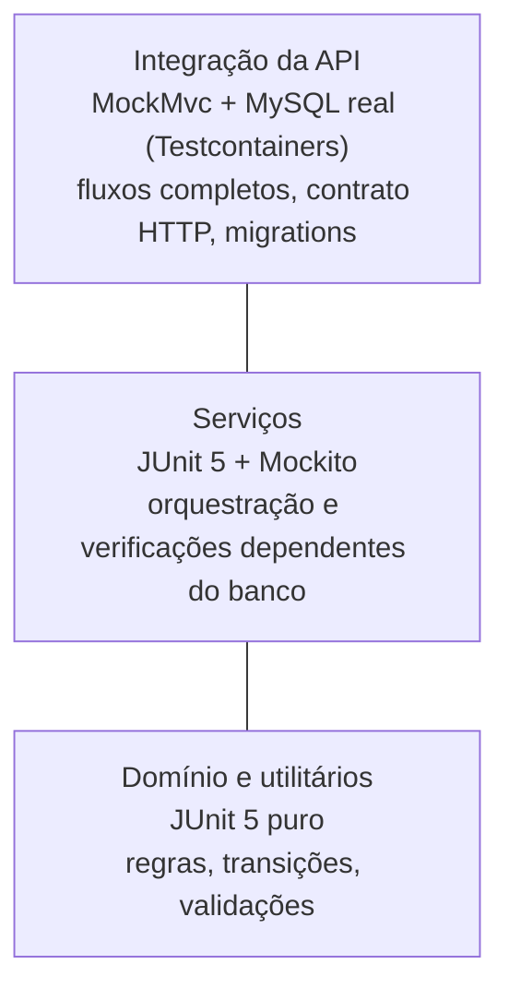

# Estratégia de Testes

**Sistema de Gerenciamento de Obrigações**

| | |
|---|---|
| **Versão** | 1.0 |
| **Data** | 25/11/2026 |
| **Autor** | rafaelsdiniz |

---

## 1. Objetivo

Garantir que as regras de negócio de [01-requisitos.md](01-requisitos.md) estejam corretas e continuem corretas a cada mudança, com testes rápidos, determinísticos e executados automaticamente no CI.

## 2. Pirâmide de testes



| Nível | O que cobre | Ferramentas | Velocidade |
|---|---|---|---|
| **Domínio** | Invariantes das entidades, máquina de estados, cálculo de atraso, CNPJ, normalização de textos, paginação | JUnit 5, AssertJ, testes parametrizados | Milissegundos |
| **Serviço** | Regras que dependem de consulta (duplicidade, situação ativa, versão), tratamento de falhas no armazenamento | JUnit 5, Mockito | Milissegundos |
| **Integração** | Requisição HTTP até o banco: validação, serialização, status HTTP, formato de erro, filtros, paginação, restrições do banco, migrations | Spring Boot Test, MockMvc, Testcontainers (MySQL 8.4) | Segundos |
| **Arquitetura** | Dependências entre camadas e módulos | ArchUnit | Milissegundos |

O banco dos testes de integração é um **MySQL real** em contêiner, e não H2, para que colações, restrições `CHECK`, tipos de data e migrations sejam testados exatamente como em produção.

## 3. Cobertura das regras de negócio

Cada regra de negócio tem pelo menos um teste que falha se ela for quebrada.

| Regras | Nível | Casos principais |
|---|---|---|
| RN-01, RN-07, RN-19 | Domínio | Criação define `ATIVO` e `PENDENTE` |
| RN-03, RN-04 | Domínio e integração | CNPJs numéricos e alfanuméricos válidos e inválidos, com e sem máscara; duplicidade gera `409` |
| RN-09 | Serviço e integração | E-mail com caixa diferente é considerado duplicado |
| RN-12 a RN-15 | Serviço e integração | Atribuir inativo gera `422`; manter vínculo inativo na edição é aceito; mudar status com vínculo inativo é aceito |
| RN-18 | Validação e integração | Vencimento ou competência fora de 2000–2100 gera `400` |
| RN-20 | Domínio e integração | Edição de concluída gera `422` |
| RN-23 a RN-26 | Domínio (parametrizado) | Todas as combinações da matriz de transições |
| RN-27, RN-28 | Integração e domínio | Requisições simultâneas de mudança de status: só uma é aplicada e o histórico não duplica; histórico registrado na ordem certa |
| RN-22 | Domínio | Atraso com `Clock` fixo: antes, no dia e depois do vencimento; concluída nunca está atrasada |
| RN-30, RN-31 | Unidade e integração | Arquivo vazio, acima do limite (inclusive pelo multipart do servidor real), extensão falsa (`.exe` renomeado para `.pdf`), XLSX x DOCX, zip truncado e *zip bomb* |
| RN-32, RN-33 | Unidade e integração | Nome sem caminho e sem caracteres invisíveis, truncado a 255 caracteres; hash SHA-256 conferido com o calculado no teste; arquivo removido do disco se o registro falhar |
| RN-34, RN-35 | Integração | Exclusão após conclusão gera `422`; anexo de outra obrigação gera `404` |
| RN-37 | Integração | Edição com versão antiga gera `409` |
| RN-39 | Unidade | Campo de ordenação não permitido gera `400`; desempate por id |

## 4. Convenções

- **O nome do método descreve o comportamento** esperado, em português: `deveSeguirOFluxoDeStatusERegistrarOHistorico`, `naoDevePularRetrocederNemAlterarObrigacaoConcluida`.
- Estrutura **Arrange / Act / Assert** com blocos separados por linha em branco.
- **Um comportamento por teste.** Variações de entrada usam `@ParameterizedTest`.
- Testes **independentes**: cada teste de integração cria os próprios dados e não depende da ordem de execução.
- **Tempo controlado**: código que depende da data atual recebe um `Clock`, fixado nos testes.
- Contêiner do MySQL **reutilizado** entre classes de teste (`@ServiceConnection` com contêiner singleton) para manter a suíte rápida.
- Sem `Thread.sleep` nem dependência de rede externa.

## 5. Frontend

| Nível | O que cobre | Ferramentas |
|---|---|---|
| Unidade | Conversão JSON ⇄ modelo, tradução de ProblemDetail em exceção, regras de exibição (próxima ação de status, atraso) | `flutter_test`, `mocktail` |
| Estado | Providers e notifiers: carregamento, sucesso, erro e paginação | `flutter_test`, `ProviderContainer` com dependências substituídas |
| Widget | Formulários (validação e envio), listas (vazia, erro, paginada), detalhe da obrigação (ações conforme o status) | `flutter_test`, `mocktail` |

## 6. Critérios de qualidade no CI

| Critério | Backend | Frontend |
|---|---|---|
| Todos os testes passando | `./mvnw verify` | `flutter test` |
| Análise estática sem avisos | compilação com `-Xlint` | `flutter analyze` |
| Formatação | `.editorconfig` | `dart format --set-exit-if-changed` |
| Cobertura de linhas medida e publicada | JaCoCo, mínimo de 90% (build falha abaixo disso) | `lcov`, publicada como artefato |
| Regras de arquitetura | ArchUnit | — |

## 7. Execução

```bash
# Backend (exige Docker para os testes de integração)
./mvnw verify
./mvnw test -Dtest=ObrigacaoTest

# Frontend
flutter test
flutter test --coverage
```
