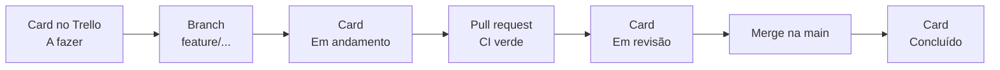

# Guia de Contribuição

**Sistema de Gerenciamento de Obrigações**

| | |
|---|---|
| **Versão** | 1.0 |
| **Data** | 25/11/2026 |
| **Autor** | rafaelsdiniz |

Padrões seguidos no backend e no frontend.

---

## 1. Fluxo de trabalho



1. Toda atividade nasce como card no [quadro do Trello](https://trello.com/b/lO3pOAnQ/sistema-de-gerenciamento-de-obrigacoes-player).
2. Uma branch por card, criada a partir da `main`.
3. Commits pequenos e coesos, cada um compilando e com testes passando.
4. Pull request descrevendo o que mudou e como foi verificado, com evidências (prints do Swagger, das telas ou do CI) quando houver.
5. Merge somente com o pipeline verde. A `main` está sempre pronta para ser implantada.

## 2. Branches

| Prefixo | Uso | Exemplo |
|---|---|---|
| `feature/` | Nova funcionalidade | `feature/obrigacoes` |
| `fix/` | Correção | `fix/filtro-cnpj-com-mascara` |
| `refactor/` | Melhoria interna sem mudar comportamento | `refactor/remocao-de-comentarios` |
| `docs/` | Documentação | `docs/documentacao-do-projeto` |
| `ci/` | Pipeline e infraestrutura | `ci/pipeline-frontend` |

## 3. Commits

Padrão [Conventional Commits](https://www.conventionalcommits.org/pt-br/), em português, no imperativo ou como descrição da mudança:

```text
<tipo>: <descrição curta em minúsculas>
```

| Tipo | Uso |
|---|---|
| `feat` | Nova funcionalidade |
| `fix` | Correção de defeito |
| `refactor` | Mudança interna sem alterar comportamento |
| `test` | Testes |
| `docs` | Documentação |
| `build` | Dependências, Docker, Maven, pubspec |
| `ci` | Pipeline |
| `chore` | Manutenção que não se encaixa nos anteriores |

Exemplos: `feat: fluxo de status das obrigações com histórico`, `test: transições inválidas de status`, `docs: documento de arquitetura`.

## 4. Padrões de código

### 4.1 Gerais

- **Código autoexplicativo, sem comentários.** Se um trecho precisa de explicação, ele ganha um nome: extrair um método, uma constante ou uma classe com nome que diga a intenção. O "porquê" das decisões vai para os [ADRs](adr/) e para o README.
- **Domínio em português** (`Obrigacao`, `alterarStatus()`, `dataVencimento`). Termos técnicos consagrados ficam em inglês quando fazem parte do framework (`Controller`, `Repository`, `Service`, `Request`, `Response`).
- Nada de código morto, código comentado, `TODO`, `System.out`/`print` ou dependência sem uso.
- Métodos curtos, com um nível de abstração. Retorno antecipado em vez de `if` aninhado.
- Imutabilidade por padrão: `record` para DTOs, `final` nos campos injetados, coleções imutáveis.

### 4.2 Backend (Java / Spring)

| Tema | Padrão |
|---|---|
| Injeção de dependência | Por construtor, sem `@Autowired` em campos |
| Entidades | Construtor `protected` para o JPA, construtor público com os dados obrigatórios, sem *setters*; mudanças por métodos de negócio |
| DTOs | `record` com `Request`/`Response`/`Filtro` no pacote `dto` do módulo; entidade nunca exposta na API |
| Conversão | Método estático `Response.de(entidade)` |
| Transações | `@Transactional(readOnly = true)` na classe do serviço e `@Transactional` nos métodos de escrita |
| Exceções | Subclasses de `ApiException`; nunca capturar e ignorar |
| Validação | Bean Validation no DTO (formato) e regra no domínio ou serviço (negócio) |
| Visibilidade | O menor escopo possível: classes auxiliares do módulo são *package-private* |
| Migrations | Nunca alterar uma migration já integrada; toda mudança é uma nova versão. É o único lugar com comentário: as V1 e V2 explicam a colação binária das colunas únicas, e removê-lo mudaria o checksum de migrations já aplicadas |
| Formatação | `.editorconfig`: 4 espaços, LF, UTF-8, 140 colunas |

### 4.3 Frontend (Dart / Flutter)

| Tema | Padrão |
|---|---|
| Lints | `flutter_lints` sem avisos |
| Formatação | `dart format` |
| Widgets | `const` sempre que possível; widgets pequenos extraídos em classes, e não em métodos que retornam `Widget` |
| Estado | Riverpod; nada de `setState` para dados vindos da API |
| Modelos | Imutáveis, com `deJson` e `paraJson` |
| Arquivos | `snake_case.dart`, um widget público por arquivo |
| Estilo visual | Só os tokens do design system: `context.cores` para cor, `Raios`, `Medidas` (largura da página, altura de controle) e `TamanhosDeIcone`; nada de cor, raio ou tamanho fixo na tela |

## 5. Pull requests

Modelo de descrição:

```markdown
## O que foi feito
- ...

## Regras de negócio atendidas
- RN-xx, RF-xx

## Como verificar
- ...

## Evidências
- prints do Swagger, das telas ou do pipeline
```

## 6. Definição de pronto

Uma atividade só vai para **Concluído** no Trello quando:

- [ ] o código segue este guia;
- [ ] as regras de negócio envolvidas têm testes;
- [ ] o pipeline está verde;
- [ ] a documentação foi atualizada (README, docs, Swagger) quando o comportamento mudou;
- [ ] o pull request foi integrado na `main`.
